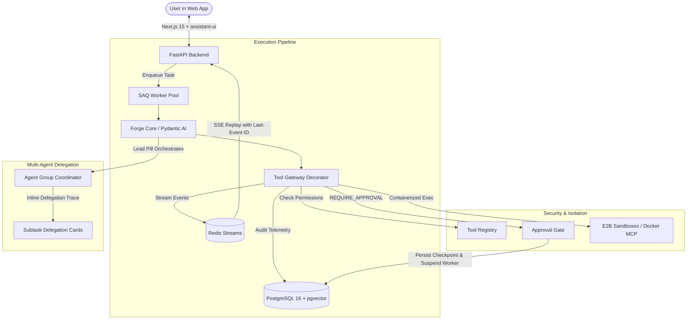

# 💊 Pills — Enterprise Multi-Agent AI Teammate Platform

[](LICENSE)
[](https://www.python.org/)
[](https://nextjs.org/)
[](https://fastapi.tiangolo.com/)
[](https://ai.pydantic.dev/)
[](https://redis.io/)
[](https://www.postgresql.org/)

> **Pills** is a self-hosted and cloud-ready AI Teammate SaaS platform. Instead of generic chat prompts, teams hire, train, and collaborate with specialized AI agents who possess distinct roles, maintain long-term partitioned memory, follow standardized operating procedures (Skills), securely interface with external systems (MCP), and execute long-running asynchronous tasks in sandboxes.

---

## 🌟 The "Pill" Metaphor & Brand Identity

In medicine, a pill is a concentrated, potent dose that targets a specific ailment. In **Pills**, each AI teammate is a specialized capsule that cures an operational headache.

Every agent is visually encapsulated as a dual-tone cylindrical pill avatar with animated **DiceBear Gaze** wandering/blinking eyes and reactive status LED halos (Idle, Thinking, Tool Execution, Approval Wait).

### 🤖 The Founding Squad

| Pill | Role | Focus Area | Avatar Styling |
|---|---|---|---|
| **Dex** | Team Lead & Orchestrator | Coordinates multi-agent initiatives, plans tasks, and synthesizes findings. | Deep Cobalt / Cyan Halo |
| **Cipher** | Security & Compliance Sentinel | Audits pull requests, inspects dependencies, checks vulnerabilities, and verifies least privilege. | Emerald / Violet Halo |
| **Pulse** | SRE & Infrastructure Sentinel | Monitors service health, queries system logs, diagnoses anomalies, and suggests incident remediations. | Amber / Orange Halo |
| **Nootrop** | Deep Research & Knowledge Lead | Conducts exhaustive primary source investigations, reads papers, and builds domain glossaries. | Amethyst / Indigo Halo |
| **Remedy** | Codebase Architect & Bug Hunter | Diagnoses complex regressions, refactors brittle interfaces, and writes deterministic test suites. | Crimson / Rose Halo |
| **Aura** | Product Strategist & Spec Crafter | Turns raw ideas into tracer-bullet specs, user stories, and design systems. | Magenta / Purple Halo |
| **Dose** | Automation & Cron Runner | Automates repetitive workflows, syncs external tools, and executes scheduled pipelines. | Teal / Slate Halo |

---

## 🏛️ System Architecture

Pills decouples conversational timelines from asynchronous execution pipelines, guaranteeing resilient event streaming and zero-worker starvation during human approval waits:



---

## ⚡ Core Architectural Principles

1. **Unified Durable Task Execution ([ADR-0001](docs/adr/0001-unified-durable-task-execution.md), [ADR-0016](docs/adr/0016-sprint-one-unified-task-engine-alignment.md))**  
   Every agent prompt or background operation instantiates a durable `Task` executed by asynchronous SAQ workers. Intermediate execution steps stream into Redis Streams, with zero throwaway code from Day 1.
2. **Resilient Event Replay via Redis Streams ([ADR-0015](docs/adr/0015-resilient-event-replay-via-redis-streams.md))**  
   All task execution events (`step.delta`, `tool.invoked`, `approval.required`) publish to Redis Streams (`task:{id}:events`). Clients reconnecting after network drops automatically replay missed events using standard `Last-Event-ID` HTTP headers.
3. **Stateless Checkpoint Resumption ([ADR-0002](docs/adr/0002-stateless-checkpoint-resumption-for-approvals.md), [ADR-0006](docs/adr/0006-interrupt-and-synthetic-tool-return-resumption.md))**  
   When an agent invokes a tool marked `REQUIRE_APPROVAL`, the Tool Gateway raises `ApprovalRequiredInterrupt`. The worker serializes model message history to `tasks.checkpoint_state` and cleanly terminates. When approved, a new worker resumes with a synthetic `ToolReturn`, preventing worker thread starvation.
4. **Tool Gateway Callable Decorator ([ADR-0014](docs/adr/0014-tool-gateway-callable-decorator-pattern.md))**  
   All tool functions are wrapped with a standardized security decorator that validates per-agent permissions (`ALLOW`, `REQUIRE_APPROVAL`, `DENY`), records duration in `task_events`, and enforces a strict 25-step cap.
5. **Sandboxed STDIO MCP & Thread-Scoped Sandboxes ([ADR-0004](docs/adr/0004-sandboxed-isolation-for-stdio-mcp.md), [ADR-0009](docs/adr/0009-thread-scoped-sandboxes-with-inactivity-ttl.md))**  
   Subprocess MCP tools and shell commands run strictly inside isolated micro-containers and E2B microVMs. Sandboxes are scoped to a Thread and automatically destroyed after 15 minutes of inactivity.
6. **Catalog-Driven Generative UI ([ADR-0003](docs/adr/0003-catalog-driven-generative-ui.md))**  
   Agents invoke a schema-validated `render_widget` tool that renders typed React widgets (`DataTableWidget`, `MetricsChartWidget`, `DiffViewerWidget`) in sandboxed iframes. Arbitrary client-side code execution (XSS risk) is strictly prohibited.
7. **Instruction-Only Skills & Immutable Releases ([ADR-0008](docs/adr/0008-instruction-only-skill-boundaries.md), [ADR-0012](docs/adr/0012-immutable-skill-version-pinning.md))**  
   Skills are declarative `SKILL.md` documents that declare prerequisite tools without bundling executable code. Pills bind to immutable, semver-pinned `skill_releases`.
8. **Hierarchical Agent Groups ([ADR-0007](docs/adr/0007-agent-groups-with-phased-membership-delegation.md), [ADR-0011](docs/adr/0011-hierarchical-group-delegation-ui.md))**  
   Agent Groups feature a designated Lead Pill (admin) who orchestrates member Pills. Subtask progress streams inside collapsible Subtask Delegation Cards, keeping the primary thread timeline focused on high-level outcomes.
9. **Partitioned Scoped Memory ([ADR-0010](docs/adr/0010-partitioned-scoped-memory-pipeline.md))**  
   Post-task memory extraction via Mem0 strictly isolates memories into User Scope, Agent Private Scope, and Organization Scope, preventing sensitive credential leakage across agents.
10. **Application-Level Tenant Context ([ADR-0013](docs/adr/0013-application-level-tenant-context-scoping.md))**  
    Tenant isolation is enforced via FastAPI dependency-injected `TenantContext` across all database sessions and background workers.

---

## 📂 Repository Structure

```
pills/
├── apps/
│   ├── web/                              # Next.js 15 Web Application
│   │   ├── app/                          # App router (auth, dashboard, workspace)
│   │   ├── components/                   # assistant-ui, Generative UI, Pill avatars
│   │   └── lib/                          # BetterAuth client, API fetchers
│   └── api/                              # FastAPI Backend
│       ├── routers/                      # threads, tasks, tools, approvals, skills
│       └── main.py                       # App initialization & middleware
├── packages/
│   ├── forge/                            # Agent execution engine over Pydantic AI
│   │   ├── core/                         # Agent runner & task loop
│   │   ├── gateway/                      # Tool Gateway decorator & approval hooks
│   │   ├── generative_ui/                # AG-UI protocol handlers & widget schemas
│   │   └── skills/                       # SKILL.md parser & validator
│   ├── database/                         # SQLModel definitions & Alembic migrations
│   └── workers/                          # SAQ background task consumer
├── docs/
│   ├── adr/                              # 16 Architectural Decision Records (0001 - 0016)
│   ├── agents/                           # Engineering skill rules (issue-tracker, domain, triage)
│   └── specs/                            # Formal specifications (0001-pills-platform-mvp.md)
├── AGENTS.md                             # Agent operational guidelines
├── GLOSSARY.md                           # Canonical domain language
├── PLAN.md                               # Comprehensive architectural roadmap
├── docker-compose.yml                    # PostgreSQL 16 + pgvector, Redis 7
└── README.md
```

---

## 🛠️ Technology Stack

| Domain | Technology | Purpose |
|---|---|---|
| **Frontend Framework** | **Next.js 15 (App Router)** | Web dashboard, SSR, streaming layouts |
| **Chat Primitives** | **assistant-ui** | Message streaming, branching, code blocks, action bars |
| **Generative UI** | **OpenIntelligentUI (CopilotKit)** | Sandboxed iframe reactive widgets via AG-UI protocol |
| **Design System** | **shadcn/ui + Tailwind CSS** | Accessible, customizable enterprise UI components |
| **Avatar Engine** | **DiceBear Gaze** | Expressive animated SVG avatars with wandering/blinking eyes |
| **Backend API** | **FastAPI** | High-performance async Python REST & SSE endpoints |
| **Agent Framework**| **Pydantic AI** | Structured agent loop, typed dependency injection |
| **LLM Gateway** | **LiteLLM** | Unified LLM provider proxy, fallbacks, and budget tracking |
| **Queue / Workers** | **SAQ + Redis 7** | Durable asynchronous task queue and event pub/sub |
| **Event Replay** | **Redis Streams** | Offset-based SSE stream replay (`Last-Event-ID`) |
| **Primary Database**| **PostgreSQL 16 + pgvector**| Relational entities, task checkpoints, vector memory |
| **Authentication** | **BetterAuth** | Multi-tenant auth, organization workspaces, session cookies |
| **Sandboxing** | **E2B + Docker** | Isolated microVM code execution and STDIO MCP containers |
| **Agent Memory** | **Mem0** | Partitioned contextual extraction (User, Agent, Org) |
| **Observability** | **Langfuse** | Distributed traces, token metrics, and execution graphs |

---

## 🚀 Run Guide & Local Setup

### Prerequisites
- **Node.js**: v20+
- **pnpm**: v10+
- **Python**: 3.12
- **uv**: Fast Python package manager ([Astral uv](https://docs.astral.sh/uv/))
- **Docker**: Docker Desktop or Docker Engine

### 1. Clone & Infrastructure
```bash
git clone https://github.com/sandilya27/Pills.git
cd Pills

# Launch PostgreSQL 16 (+ pgvector) and Redis 7
docker compose up -d
```

### 2. Install Workspace Dependencies
```bash
# Python workspace dependencies (apps/api and packages/forge)
uv sync --python 3.12

# Node.js workspace dependencies (apps/web)
pnpm install
```

### 3. Seed Development Database
```bash
pnpm db:seed
# Or: uv run --directory apps/api python -m api.db.seed
```

### 4. Run Development Servers
```bash
# Run FastAPI Backend on :8000
pnpm dev:api
# Or: uv run --directory apps/api uvicorn api.main:app --reload --port 8000

# Run Next.js 15 Web Application on :3000
pnpm dev:web
# Or: pnpm --filter @pills/web dev
```
- **Web Client**: [http://localhost:3000](http://localhost:3000)
- **FastAPI OpenAPI Docs**: [http://localhost:8000/docs](http://localhost:8000/docs)
- **Healthcheck Endpoint**: [http://localhost:8000/api/v1/health](http://localhost:8000/api/v1/health)

### 5. Run Test Suites
```bash
# Run backend tenant isolation & API test suite (Pytest)
pnpm test:api

# Run frontend end-to-end component test suite (Vitest)
pnpm test:web

# Run all test suites across the monorepo
pnpm test
```

---

## 🤝 Contributing

Contributions, bug reports, and pull requests are warmly welcomed! Please read our [**Contributing Guide (CONTRIBUTING.md)**](CONTRIBUTING.md) for details on:
- Domain language rules and entity conventions ([`GLOSSARY.md`](GLOSSARY.md))
- Settled architectural decisions ([`docs/adr/`](docs/adr/))
- Branch naming and Conventional Commit guidelines
- Triage labels and issue tracking workflows ([`docs/agents/`](docs/agents/))
- Public-seam testing standards

---

## 📖 Specifications & Domain Model

- **[GLOSSARY.md](GLOSSARY.md)**: Canonical domain terms (`Pill`, `Skill`, `Thread`, `Task`, `Tool Gateway`, `Approval Gate`, `Task Checkpoint`).
- **[Architectural Decision Records](docs/adr/)**: 16 settled ADRs governing execution, security, sandboxing, memory, and multi-agent coordination.
- **[MVP Specification](docs/specs/0001-pills-platform-mvp.md)**: Comprehensive specification tracking user stories, schemas, and testing seams.
- **[Parent GitHub Issue #1](https://github.com/sandilya27/Pills/issues/1)**: Live tracking issue on GitHub.
- **[CONTRIBUTING.md](CONTRIBUTING.md)**: Operational and engineering guidelines for contributors.

---

## 📄 License

Pills is licensed under the **MIT License**.

